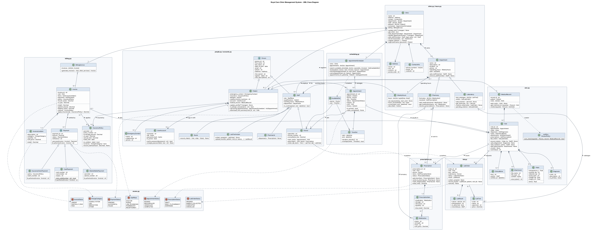

# Royal Care Clinic – Healthcare Clinic Management System

## Attribution

This project was developed by:

- **Ayesha Thani Mohammad Bin Hendi Almheiri**
- **Noora Adel Mohamed Abdulla Baqer**

---

An object-oriented Python application for Royal Care Clinic, a modern outpatient
clinic. It manages the clinic profile and departments, patients, doctors and
staff, appointment scheduling, electronic medical records (EMR), prescriptions,
laboratory orders and billing with insurance and co-pay calculation.

The goals are a better patient experience, less administrative work, and safe
handling of medical data. To protect that data, passwords are hashed, every
read of a medical record is access-checked, and lab results are validated
against the correct patient and visit.

- **Language:** Python 3.10 or newer
- **Dependencies:** none. Only the Python standard library is used.
- **Design:** UML class diagram with 40 classes, implemented as 15 modules

---

## Contents

- [Features](#features)
- [Project structure](#project-structure)
- [Getting started](#getting-started)
- [Example run](#example-run)
- [Class design](#class-design)
- [Business rules](#business-rules)
- [Testing](#testing)
- [UML class diagram](#uml-class-diagram)
- [Assumptions](#assumptions)

---

## Features

| Area | What it does |
|------|--------------|
| **Clinic information** | Clinic profile (name, address, phone numbers, email, website) and departments: General Practice, Cardiology, Paediatrics, Laboratory, Radiology, Pharmacy. Each department has its own operating hours. Information can be added, updated and retrieved. |
| **Patient management** | Patients create an account with a hashed password. Profiles hold personal details, emergency contact, insurance, allergies and a medical history summary. Patients can update their profile, view upcoming appointments and download visit summaries. |
| **Doctors & staff** | Doctor, Nurse, Lab Technician and Pharmacist roles, with qualifications, weekly working hours and department assignment. Multiple doctors can be searched by speciality. |
| **Appointment scheduling** | Search free slots by date, doctor or speciality. Book, reschedule and cancel appointments. Double booking of doctors or patients is prevented, and bookings outside working hours are rejected. |
| **Electronic medical records** | Each visit records clinical notes, vitals (with BMI), ICD-10 diagnoses, attachments, prescriptions and lab orders. Doctors and staff can read records; a patient can read only their own. |
| **Prescriptions** | Drug name, dosage, directions and quantity. The patient's allergies are checked before prescribing. Status moves DRAFT → SENT_TO_PHARMACY → DISPENSED. |
| **Laboratory** | Doctors order tests from the lab catalogue. Status moves ORDERED → SAMPLE_COLLECTED → COMPLETED. A result is accepted only if it matches the order's patient and visit. |
| **Billing & insurance** | One invoice per visit, covering consultation, lab, medication and other services. Insurance coverage, flat co-pay and the annual limit are applied. Payment by card (Luhn-validated), mobile wallet or insurance claim. |

---

## Project structure

```
royal-care-clinic/
├── royal_care/                 # application package
│   ├── __init__.py             # public API (re-exports main classes)
│   ├── enums.py                # status / role enumerations
│   ├── exceptions.py           # custom exception hierarchy
│   ├── utils.py                # ID generator, money helpers, dates
│   ├── hours.py                # WeeklyHours (operating / working hours)
│   ├── clinic.py               # Clinic, Address, ContactInfo, Department, Laboratory, Pharmacy
│   ├── accounts.py             # UserAccount (patient login, hashed passwords)
│   ├── people.py               # Person, Patient, Staff, Doctor, Nurse, LabTechnician, Pharmacist
│   ├── scheduling.py           # TimeSlot, AvailableSlot, Appointment, AppointmentScheduler
│   ├── emr.py                  # MedicalRecord, Visit, Vitals, Diagnosis, Attachment, AccessPolicy
│   ├── prescriptions.py        # Medication, Prescription, PrescriptionItem
│   ├── lab.py                  # LabTest, LabOrder, LabResult
│   ├── billing.py              # Invoice, InsurancePolicy, Payment and its subclasses
│   ├── formatting.py           # console output helpers (tables, headings)
│   └── sample_data.py          # builds the sample Royal Care Clinic
├── tests/
│   └── test_clinic_system.py   # 31 unit and scenario tests
├── docs/
│   ├── uml_class_diagram.puml  # UML source (PlantUML)
│   ├── uml_class_diagram.png   # rendered diagram
│   └── uml_class_diagram.svg   # scalable version
├── main.py                     # end-to-end demonstration
└── README.md
```

The modules are layered so that dependencies flow in one direction:

| Layer | Modules |
|-------|---------|
| Foundation | `enums`, `exceptions`, `utils`, `hours` |
| Domain | `accounts`, `scheduling`, `emr`, `prescriptions`, `lab`, `billing` |
| Aggregates / facade | `people`, `clinic` |
| Presentation / setup | `formatting`, `sample_data`, `main.py` |

Where two modules only need each other's types for annotations, the import is
placed under `typing.TYPE_CHECKING`. This avoids circular imports at run time.

---

## Getting started

```bash
# 1. Clone the repository
git clone https://github.com/noorabaqer/royal-care-clinic.git
cd royal-care-clinic

# 2. Run the end-to-end demonstration
python main.py

# 3. Run all tests
python -m unittest discover -s tests -v
```

There is nothing to install. On Windows, use `py` instead of `python` if
`python` is not on your PATH.

### Using the package in your own code

```python
from datetime import date
from royal_care.sample_data import build_royal_care_clinic

clinic = build_royal_care_clinic()
patient = clinic.register_patient("Aliyah", "Johnson", date(1996, 7, 19),
                                  "+1 876 555 0199", "aliyah@example.com", None,
                                  username="aliyahj", password="Secure#2026")
dr_brown = clinic.doctors("General Practice")[0]

slots = clinic.scheduler.search_available_slots(date(2026, 11, 2), doctor=dr_brown)
appointment = clinic.scheduler.book(patient, dr_brown, slots[0].slot.start, 30, "Check-up")
print(appointment)   # APT-0001: Aliyah Johnson with Dr. Michael Brown on ... [BOOKED]
```

---

## Example run

`main.py` walks through the scenario from the assignment brief:

1. The clinic profile, departments and doctors are displayed.
2. Patient **Aliyah** registers, with insurance and a recorded penicillin allergy.
3. She searches for available slots and books a 30-minute appointment with
   **Dr. Brown (General Practitioner)** next Monday. She then reschedules it and
   cancels a second appointment.
4. Dr. Brown starts the visit. A nurse records the vitals, the doctor adds a
   diagnosis, orders a Full Blood Count and issues a prescription. A prescription
   for the drug she is allergic to is blocked.
5. The lab technician uploads the result (status `COMPLETED`), and the pharmacist
   dispenses the medication.
6. An invoice is generated with insurance applied. It is paid by insurance claim,
   mobile wallet and card, and its status becomes `PAID`.
7. Access control is demonstrated, and the patient downloads a visit summary.

An excerpt of the billing output:

```
  Invoice       : INV-0001
  Total charges : $135.80
  Insurance     : Sagicor Health #SH-778812 - 80% cover, co-pay $20.00
  Co-pay        : $20.00
  Insurer pays  : $92.64
  Patient pays  : $43.16

  Balance due: $0.00 -> invoice PAID
```

---

## Class design

The system uses all the main kinds of UML relationship:

| Relationship | Examples |
|--------------|----------|
| **Inheritance** | `Person` (abstract) → `Patient`, `Staff`; `Staff` → `Doctor`, `Nurse`, `LabTechnician`, `Pharmacist`; `Department` → `Laboratory`, `Pharmacy`; `Payment` (abstract) → `CardPayment`, `MobileWalletPayment`, `InsuranceClaimPayment` |
| **Composition** | `Clinic` owns its `Department`s, `AppointmentScheduler` and `BillingService`; `Patient` owns a `MedicalRecord`; `MedicalRecord` owns its `Visit`s; `Visit` owns its `Vitals`, `Diagnosis`, notes and attachments; `Prescription` owns its items; `Invoice` owns its line items |
| **Aggregation** | `Department` groups `Staff`; `Clinic` registers `Patient`s; `Invoice` is settled by `Payment`s; `Laboratory` and `Pharmacy` hold catalogue items |
| **Association** | `Appointment` links a `Patient` and a `Doctor`; `Visit` issues `Prescription`s and `LabOrder`s; `Patient` is insured by an `InsurancePolicy` |
| **Dependency** | `AppointmentScheduler` creates `AvailableSlot`s; `MedicalRecord` uses `AccessPolicy` |

The design applies these object-oriented principles:

- **Encapsulation:** state is held in private attributes and exposed through
  read-only properties and validated methods.
- **Abstraction and polymorphism:** `Person.role_description()` and
  `Payment._authorise()` are abstract methods that each subclass implements
  in its own way.
- **Template method pattern:** `Payment.process()` defines the shared steps once.
  Subclasses supply only the authorisation step.
- **Facade:** `Clinic` provides a single entry point to every service.
- **Fail fast:** invalid input raises a specific `ClinicError` subclass, such as
  `ValidationError`, `SlotUnavailableError`, `InvalidStateError`,
  `AccessDeniedError` or `PaymentError`.

---

## Business rules

**Insurance and co-pay calculation**

```
eligible  = sum of charges in categories the policy covers
co_pay    = policy's flat co-pay (never more than eligible)
insurer   = (eligible - co_pay) × coverage %, capped at the remaining annual limit
patient   = invoice total - insurer
```

**Other rules**

- A doctor cannot be double-booked, and a patient cannot hold two overlapping
  appointments.
- Appointments must fall inside the doctor's working hours.
- Cancelled or completed appointments cannot be rescheduled, cancelled again or
  used to start a visit.
- A visit can have only one primary diagnosis. Once a visit is closed it is
  read-only, and its appointment becomes `COMPLETED`.
- A prescription cannot be edited after it has been sent to the pharmacy.
- Insurance claims settle the insurer's share. Card and mobile wallet payments
  settle the patient's share, and overpayment is rejected.
- Money uses `Decimal` rounded to cents, never `float`.

---

## Testing

`tests/test_clinic_system.py` contains **31 tests**, grouped by feature:

| Brief item | Test class | What is verified |
|------------|------------|------------------|
| – | `TestClinicInformation` | Profile retrieval, updates, departments and operating hours |
| a | `TestPatientAccountCreation` | Data stored correctly, login, duplicate/invalid data rejected, profile update |
| b | `TestSearchAvailableAppointments` | Slots generated from doctor schedules, booked slots excluded, filters |
| c | `TestMakeAppointment` | `BOOKED` status, double booking and out-of-hours rejected, rescheduling |
| d | `TestVisitRecordingAndEMR` | Visit linked to appointment, vitals and diagnosis, access control, summary download |
| e | `TestPrescriptionGeneration` | `SENT_TO_PHARMACY` status, allergy check, dispensing |
| f | `TestLabOrderLifecycle` | `ORDERED` → `SAMPLE_COLLECTED` → `COMPLETED`; wrong patient/visit rejected |
| g | `TestInvoiceAndPayment` | Line totals, co-pay, insurer share, payments, invalid card, limits |
| h | `TestAppointmentCancellation` | `CANCELLED` status, slot freed, cancelled appointment cannot be reused |
| Examples | `TestExampleScenarios` | (1) Aliyah with Dr. Brown, end to end; (2) uninsured cardiology patient who reschedules and pays by mobile wallet |

```bash
python -m unittest discover -s tests -v
# ...
# Ran 31 tests in 2.0s
# OK
```

---

## UML class diagram



The diagram source is `docs/uml_class_diagram.puml`. To regenerate the image
with [PlantUML](https://plantuml.com/):

```bash
java -jar plantuml.jar -tpng docs/uml_class_diagram.puml
java -jar plantuml.jar -tsvg docs/uml_class_diagram.puml
```

---

## Assumptions

- The system manages a single clinic, and data is kept in memory. A database
  could be added behind the same classes.
- Appointment slots are generated from doctors' weekly working hours in
  30-minute steps by default. The step length is configurable.
- One visit is recorded per appointment.
- Any staff member may view visit summaries. Patients may view only their own records.
- Payment gateways are simulated: card numbers are checked with the Luhn
  algorithm and the expiry date is checked.
